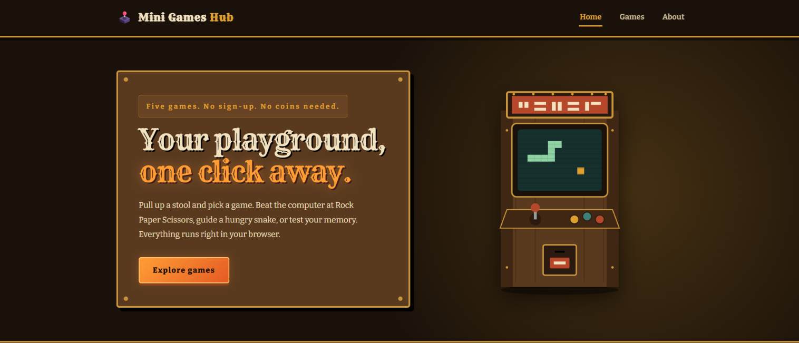
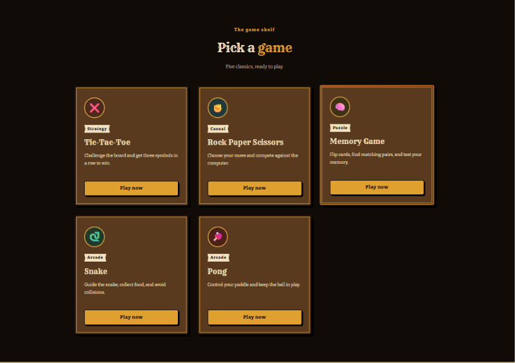
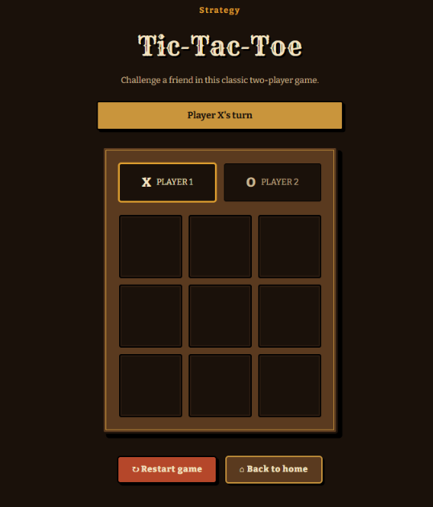
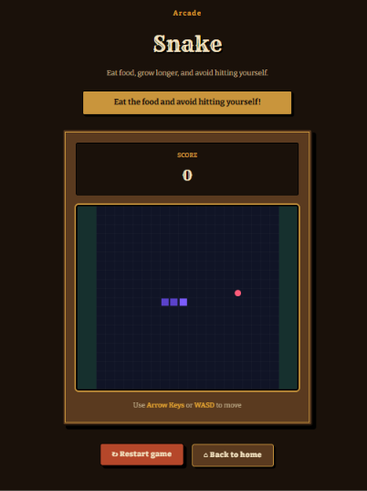
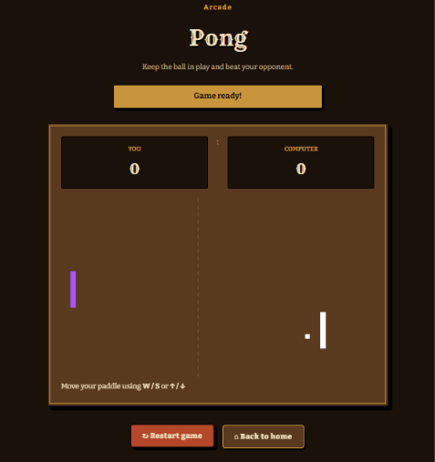

# 🎮 Mini Games Hub

A retro-inspired browser gaming platform featuring five classic mini-games, interactive gameplay, and a custom-designed arcade UI. Built using HTML, CSS, and JavaScript.

<p align="center">
  <a href="https://minigameshub-kappa.vercel.app/">
    
  </a>
  
  
  
</p>

---

## 🚀 Live Demo

**Play here:** [Mini Games Hub](https://minigameshub-kappa.vercel.app/)

---

## 📖 About

Mini Games Hub is a browser-based gaming website developed as a college mini-project. It brings multiple classic games together under one platform with interactive gameplay, intuitive navigation, and responsive design.

The project focuses on frontend development, game logic implementation, DOM manipulation, event handling, and responsive UI/UX.

---

## 📸 Screenshots

<!-- Add your screenshots inside the screenshots/ folder -->

### 🏠 Homepage


### 🎯 Games Collection


### ❌⭕ Tic-Tac-Toe


### 🐍 Snake


### 🏓 Pong


---

## 🎮 Games Included

| Game | Description |
|---|---|
| ❌⭕ Tic-Tac-Toe | Classic two-player game where the first to align three symbols wins. |
| ✊✋✌️ Rock Paper Scissors | Play against the computer using the classic three-choice game. |
| 🧠 Memory Match | Flip cards and find matching pairs using your memory. |
| 🐍 Snake | Collect food, grow longer, and avoid collisions. |
| 🏓 Pong | Control your paddle, return the ball, and compete against the computer. |

---

## ✨ Features

- Five playable mini-games in one website
- Interactive game mechanics and controls
- Game restart functionality
- Seamless navigation between games
- Responsive layout for different screen sizes
- Custom-designed arcade-inspired UI/UX
- Lightweight and fast
- No installation required to play

---

## 🛠️ Tech Stack

| Technology | Usage |
|---|---|
| HTML5 | Structure and content |
| CSS3 | Styling, layouts, animations, responsiveness |
| JavaScript | Game logic and interactivity |
| Canvas API | Rendering for canvas-based games |
| Git & GitHub | Version control and repository hosting |
| Vercel | Deployment and hosting |

---

## 📂 Project Structure

```text
MINI-GAMES-HUB/
│
├── index.html
│
├── css/
│   ├── style.css
│   ├── games.css
│   └── responsive.css
│
├── js/
│   ├── main.js
│   ├── navigation.js
│   └── games/
│       ├── tic-tac-toe.js
│       ├── rock-paper-scissors.js
│       ├── memory.js
│       ├── snake.js
│       └── pong.js
│
├── assets/
│   └── images/
│
├── screenshots/
│
└── README.md
```

---

## ▶️ Run Locally

1. Clone the repository:

   ```bash
   git clone YOUR_GITHUB_REPOSITORY_URL
   ```

2. Navigate into the project folder:

   ```bash
   cd MINI-GAMES-HUB
   ```

3. Open the project in VS Code.

4. Run `index.html` using Live Server.

---

## 🎯 Project Objectives

- Build a multi-game web application using frontend technologies.
- Implement game logic using JavaScript.
- Practice DOM manipulation and event handling.
- Develop responsive and user-friendly interfaces.
- Organize code into modular files.
- Gain practical experience in debugging and deployment.

---

## 🔮 Future Enhancements

- High-score tracking using Local Storage
- Sound effects and background music
- Additional mini-games
- Difficulty settings
- Leaderboard
- Enhanced animations and transitions

---

## 👨‍💻 Developer

**Tilak Mehrotra**

BCA Student | Web Development & Software Development Enthusiast

---

<p align="center">
  Made with ❤️ and JavaScript
</p>